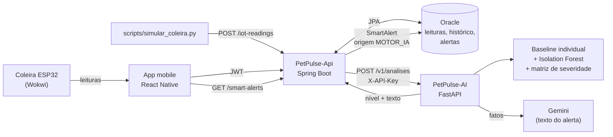
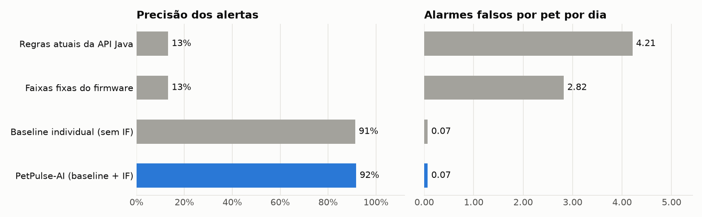
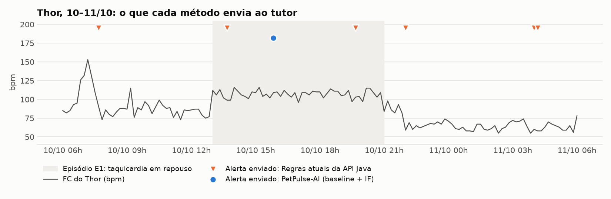

# 🐾 PetPulse-AI

Motor de Inteligência Artificial do **PetPulse** (Challenge FIAP 2026 · CLYVO VET · Disruptive Architectures: IoT, IoB & Generative IA, 4ª Sprint).

Ele implementa a solução de IA definida na entrega anterior ([`IoT_Ia_Sprint3_Petpulse.docx`](IoT_Ia_Sprint3_Petpulse.docx)): **detecção de anomalias não supervisionada sobre a telemetria da coleira, com baseline individual por pet, e alertas contextuais em linguagem natural**. O motor está integrado à API Java (Oracle) e ao app mobile.

- 🎥 **Vídeo pitch:** _(link do YouTube não listado)_
- 📓 **Notebook da demonstração:** [PetPulse_IA_Sprint4.ipynb](PetPulse_IA_Sprint4.ipynb)
- 📊 **Resultados:** [seção Resultados](#resultados) · [relatório completo](avaliacao/resultados.md)
- 🧭 **Roteiro do vídeo:** [docs/roteiro_video.md](docs/roteiro_video.md)

## Rodar a IA só com a chave do Gemini

[](https://colab.research.google.com/github/Fiap-2tdspg-Challenge/PetPulse-AI/blob/main/PetPulse_IA_Sprint4.ipynb)

1. Abra o notebook no Colab pelo botão acima.
2. No ícone de chave 🔑 (**Secrets**), crie `GEMINI_API_KEY` com uma chave do [Google AI Studio](https://aistudio.google.com/apikey).
3. **Ambiente de execução → Executar tudo.**

Não é preciso banco de dados, API Java ou deploy. O notebook gera os dados e mostra cada pilar da IA funcionando, roda as 4 simulações pelo mesmo endpoint que a API Java usa e exibe a avaliação.

Para rodar na própria máquina (VS Code com as extensões Python e Jupyter):

1. Crie o ambiente com `python -m venv .venv` e depois `.venv\Scripts\pip install -r requirements-dev.txt`.
2. Copie `.env.example` para `.env` e cole a chave em `GEMINI_API_KEY=`.
3. Abra `PetPulse_IA_Sprint4.ipynb`, selecione o kernel `.venv` e clique em **Run All**.

## 👥 Integrantes (2TDSPG)

- Gabriel Neris Losano — RM564093
- João Vitor Biribilli Ravelli — RM565594
- Pedro de Matos Previtali — RM564184
- Pietro Paranhos Wilhelm — RM561378

---

## 1. O problema que a IA resolve

Pets mascaram sinais de doença, e o tutor não sabe interpretar gráficos de sensores. A API usava **limites fixos iguais para todos os animais** (FC < 60 ou > 180, pressão > 16, atividade < 2). Isso gera dois erros:

- **Falsos negativos:** a FC do Thor (Labrador) sobe de ~82 para ~107 bpm em repouso, um aumento de 30%, e nenhum limite fixo dispara.
- **Falsos positivos:** o Bob (Border Collie atleta) dorme com 48 bpm e "dispara" toda noite; a Nina (gata) tem FC normal acima de 160.

A proposta da Sprint 3 era trocar as réguas fixas por **personalização real**: aprender o normal de cada pet e avisar quando ele sai do próprio padrão.

## 2. Como a IA funciona (os 3 pilares da Sprint 3)

| Pilar (Sprint 3) | Implementação | Arquivo |
|---|---|---|
| **1. Baseline individual dinâmica** | Para cada pet e cada contexto (repouso diurno, repouso noturno, caminhada, corrida), uma regressão linear aprende o valor esperado de FC, temperatura e pressão em função da atividade do momento. A dispersão é medida de forma robusta (mediana/MAD), e a regressão é reajustada sem outliers. A baseline só aprende com dados de **mais de 24 h atrás**, para que um episódio longo não vire "normal". | [`app/ml/baseline.py`](app/ml/baseline.py) |
| **2. Detecção multivariada de anomalias** | **Isolation Forest** (scikit-learn), um modelo por pet treinado só com o histórico dele (FC, temperatura, pressão, atividade e hora do dia em seno/cosseno). Ele confirma desvios mais sutis (\|z\| ≥ 2 só conta se o IF também marcar a leitura como anômala) e dá o `scoreAnomalia`. Os modelos ficam em cache e são retreinados a cada hora. | [`app/ml/detector.py`](app/ml/detector.py) |
| **3. Alertas contextuais inteligentes** | **Gemini** (`google-genai`, Interactions API, `gemini-3.5-flash`) recebe só os fatos calculados e devolve JSON validado por **Pydantic** (título, mensagem, recomendação). Guardrails conferem o texto; se algo falhar, entra um template determinístico. | [`app/genai/alerta.py`](app/genai/alerta.py) |

Além dos pilares:

- **Matriz de severidade (Sprint 3, seção 8B)** em [`app/ml/motor.py`](app/ml/motor.py):

  | Nível | Quando | Conduta |
  |---|---|---|
  | **BAIXO** | Desvio isolado, sem persistência (ex.: um pico de 205 bpm) | Só registro e monitoramento (não notifica) |
  | **MÉDIO** | Desvio persistente (≥ 50% da janela de 6 h e ativo na última hora), desvios combinados, ou queda de ≥ 30% da atividade em 24 h | Alerta preventivo e consulta de rotina |
  | **ALTO** | Desvios combinados com pelo menos um severo (\|z\| ≥ 5 ou febre ≥ 39,5 °C), ou limite crítico confirmado em 2 das 3 últimas leituras | Atendimento veterinário imediato e notificação push |

- **Contexto clínico:** o histórico clínico do pet entra na análise. Uma vacina nas últimas 72 h **rebaixa um nível** quando as alterações são compatíveis com reação vacinal (temperatura < 39,5 °C, queda de atividade, FC até +20%). Medicação, doença e exames recentes são citados no alerta.
- **Cold start:** com menos de 24 h de histórico, o motor usa faixas de referência por espécie, porte e idade (as mesmas do firmware da coleira).
- **O ML decide, o LLM explica:** o nível de risco é calculado de forma auditável (o campo `justificativa` mostra o caminho). O Gemini não consegue mudar a severidade, assim como no Checkpoint 4 o modelo não calculava preços.

## 3. Arquitetura e integração



Fluxo de uma leitura:

1. A coleira (ou o simulador) envia `POST /iot-readings` para a API Java, que grava no Oracle (agora com `temperature` e `readingDate`).
2. Se a leitura é recente (última hora), o `IoTReadingAnalysisService` monta o pedido: perfil do pet, leituras dos últimos 14 dias e histórico clínico.
3. O PetPulse-AI valida e limpa os dados, roda o motor e, se for MÉDIO ou ALTO, pede o texto ao Gemini.
4. A API Java grava o `SmartAlert` com origem `MOTOR_IA`. Ela não duplica alertas: se já houver um alerta de IA aberto nas últimas 6 h com risco igual ou maior, o novo é descartado.
5. O app mobile mostra o alerta no sino da Home com o selo **"Análise da IA"** e envia notificação local quando o risco é ALTO.
6. Se o PetPulse-AI não responder (timeout, fora do ar), a API aplica as regras fixas antigas: o tutor nunca fica sem cobertura.

Mudanças nos outros repositórios (Sprint 4):

| Repositório | Mudança |
|---|---|
| [PetPulse-Api](https://github.com/Fiap-2tdspg-Challenge/PetPulse-Api) | Pacote `ai/` (`AiAnalysisClient` com timeout e contingência, DTOs do contrato), `IoTReadingAnalysisService` chamando a IA com deduplicação, `AiServiceProperties`, migration `V8__ai_integration.sql` (coluna `TEMPERATURA`, origem `MOTOR_IA`, tipos `TEMPERATURA`/`ANOMALIA_MULTIVARIADA`), `temperature` e `readingDate` opcionais em `POST /iot-readings` |
| [PetPulse-mobile](https://github.com/Fiap-2tdspg-Challenge/PetPulse-mobile) | Tipo `MOTOR_IA` e selo "Análise da IA" nos alertas da Home |

## 4. Tecnologias

| Camada | Tecnologia |
|---|---|
| API do serviço | Python 3.12+, FastAPI, Uvicorn |
| Validação e contratos | Pydantic v2 (entrada, saída e saída estruturada do LLM) |
| Machine learning | scikit-learn (`IsolationForest`, `RobustScaler`), NumPy |
| IA generativa | Google Gemini via `google-genai` (Interactions API, saída JSON com schema) |
| Testes | pytest, `fastapi.testclient`, cliente Gemini falso |
| Dados e avaliação | NumPy, pandas, Matplotlib |
| Deploy | Docker (pronto para Render) |

### Decisões técnicas e relação com as aulas

| Decisão | Por quê | Aula de referência |
|---|---|---|
| **Isolation Forest** (não supervisionado), e não KNN ou árvore de decisão | Não temos exemplos rotulados de "pet doente" para cada animal. A Sprint 3 já definia aprendizado não supervisionado. KNN e árvore precisariam de milhares de casos rotulados. | Lab 02 (classificadores supervisionados), como contraponto |
| **Regressão linear** para a FC/pressão esperada em função da atividade | É o modelo mais simples que explica a relação "mais atividade, mais FC" de cada pet. | Lab 03 (regressão) |
| **`RobustScaler`** em vez de `StandardScaler`/`MinMaxScaler` | A coleira manda picos e lixo (999 bpm). O `RobustScaler` usa mediana e intervalo interquartil, então esses valores não distorcem a escala. | Lab 04 (pré-processamento) |
| **Métricas do scikit-learn** e comparação entre métodos | `precision_score`, `recall_score`, `f1_score`, `confusion_matrix` e `classification_report`, comparando quatro métodos lado a lado. | Labs 02, 05 e 06 |
| **Separação desenvolvimento × teste** | Os parâmetros foram ajustados no dataset de semente 42. O resultado também é medido num dataset gerado com outra semente (2026), que não foi usado durante o desenvolvimento. | Labs 02 e 05 (`train_test_split`, validação) |
| **Gemini via `google-genai`** com saída estruturada | Mesmos padrões dos labs: `client.interactions.create`, `system_instruction`, few-shot, `response_format` com schema Pydantic e `model_validate_json`. O modelo não decide o risco, como no CP4, em que ele não calculava preço. | Labs 1, 2 e 3; CP4 |
| **FastAPI** em vez de Flask | O Lab 3.5 deixa o framework a critério do grupo. O FastAPI valida a entrada com os mesmos modelos Pydantic usados com o Gemini e gera o Swagger (`/docs`) sozinho, como o Springdoc da nossa API Java. | Lab 3.5; CP5 (Flask) |
| **SQLite** para o histórico das análises | O Lab 3.5 pede que resultados e logs sobrevivam a um restart. O `sqlite3` é da biblioteca padrão e não precisa de servidor. O alerta oficial continua no Oracle. | Lab 3.5 |
| **Docker** | Serve o modelo como um serviço REST independente. | Lab 12 (deploy com Docker) |
| **Notebook no Colab** | Roda tudo só com a `GEMINI_API_KEY` dos Secrets. | Labs de GenAI; CP4 |

## 5. Estrutura do repositório

```text
PetPulse-AI/
├── PetPulse_IA_Sprint4.ipynb  # notebook Colab: demonstração completa (só precisa da GEMINI_API_KEY)
├── app/
│   ├── main.py              # FastAPI: GET /health, POST e GET /v1/analises
│   ├── config.py            # variáveis de ambiente
│   ├── schemas.py           # contratos Pydantic (camelCase no JSON)
│   ├── repositorio.py       # histórico das análises em SQLite
│   ├── ml/
│   │   ├── preparacao.py    # limpeza, validação, normalização (cmHg→mmHg, fuso, duplicadas)
│   │   ├── baseline.py      # Pilar 1: baseline individual por contexto
│   │   ├── detector.py      # Pilar 2: Isolation Forest por pet
│   │   ├── referencias.py   # faixas por espécie/porte/idade e limites críticos
│   │   └── motor.py         # persistência, matriz de severidade, contexto clínico
│   └── genai/
│       ├── prompts.py       # system prompt + exemplo few-shot
│       └── alerta.py        # Pilar 3: Gemini + guardrails + template
├── dados/
│   ├── gerar_dataset.py     # gera o dataset sintético rotulado
│   ├── leituras.csv         # desenvolvimento (semente 42): 8.064 leituras, 4 pets × 14 dias
│   ├── pets.json            # perfis + histórico clínico
│   ├── episodios.json       # 7 episódios rotulados (rótulos de verdade)
│   └── teste/               # dataset de teste (semente 2026), não usado no desenvolvimento
├── avaliacao/
│   ├── avaliar.py           # simulação leitura a leitura e métricas (scikit-learn)
│   ├── graficos.py          # gráficos do README
│   ├── resultados.md/json   # resultados no dataset de desenvolvimento
│   └── teste/               # resultados no dataset de teste
├── scripts/simular_coleira.py  # demonstração ponta a ponta contra a API Java
├── tests/                   # 39 testes automatizados
├── docs/roteiro_video.md
├── Dockerfile
└── IoT_Ia_Sprint3_Petpulse.docx  # especificação da Sprint 3
```

## 6. Como executar

O jeito mais rápido é o notebook no Colab ([seção acima](#rodar-a-ia-só-com-a-chave-do-gemini)). Para subir o serviço que a API Java chama, o pré-requisito é Python 3.12 ou superior:

```bash
python -m venv .venv
# Windows: .venv\Scripts\activate   |   Linux/macOS: source .venv/bin/activate
pip install -r requirements-dev.txt
cp .env.example .env        # opcional: preencha GEMINI_API_KEY
uvicorn app.main:app --reload --port 8000
```

- Swagger: <http://localhost:8000/docs>
- Health: <http://localhost:8000/health> (mostra se os textos vêm do Gemini ou do template)

Variáveis de ambiente ([`.env.example`](.env.example)):

| Variável | Uso |
|---|---|
| `GEMINI_API_KEY` | Chave do Google AI Studio. Sem ela, tudo funciona e os textos usam o template. |
| `GEMINI_MODEL` | Padrão `gemini-3.5-flash` |
| `GEMINI_TIMEOUT_S` | Tempo máximo de espera pelo Gemini (padrão 20 s; na prática ele responde em ~10 s) |
| `AI_SERVICE_KEY` | Se definida, exige o header `X-API-Key` (a API Java envia o mesmo valor) |

Com Docker:

```bash
docker build -t petpulse-ai .
docker run -p 8000:8000 --env-file .env petpulse-ai
```

Para ligar a API Java ao serviço, defina na API `AI_SERVICE_URL=http://localhost:8000` (e `AI_SERVICE_KEY`, se usar). Os detalhes estão no README do PetPulse-Api.

## 7. Contrato: `POST /v1/analises`

Requisição (enviada pela API Java):

```json
{
  "pet": { "id": 1, "nome": "Thor", "especie": "cao", "raca": "Labrador", "porte": "grande",
           "idadeAnos": 6, "pesoKg": 32, "sexo": "M" },
  "leituras": [
    { "dataLeitura": "2026-10-10T19:00:00", "frequenciaCardiaca": 108, "nivelAtividade": 9.5,
      "pressao": 137, "temperatura": 38.5 }
  ],
  "historicoClinico": [ { "tipo": "VACINA", "descricao": "V10", "data": "2026-03-12" } ],
  "gerarTexto": true
}
```

Resposta (resumida):

```json
{
  "petId": 1,
  "nivelRisco": "MEDIO",
  "gerarAlerta": true,
  "tipoAlerta": "FREQUENCIA_CARDIACA",
  "modo": "baseline_individual",
  "scoreAnomalia": 0.92,
  "desvios": [{ "sinal": "frequencia_cardiaca", "direcao": "acima", "tipo": "persistente",
                "valorAtual": 107.0, "referencia": 81.6, "desvioPercentual": 31.1,
                "zRobusto": 6.39, "contexto": "repouso", "persistenciaHoras": 5.8 }],
  "contextoClinico": [],
  "justificativa": ["Desvio persistente em frequencia_cardiaca → MEDIO."],
  "alerta": {
    "titulo": "Mudança no padrão de frequência cardíaca do Thor",
    "mensagem": "A frequência cardíaca do Thor está 31% acima do padrão dele em repouso há cerca de 6 h (107 bpm; o habitual é 82 bpm).",
    "recomendacao": "Observe o Thor nas próximas horas (apetite, respiração e disposição) e agende uma consulta de rotina com o veterinário.",
    "geradoPor": "gemini"
  },
  "leiturasValidas": 1008,
  "valoresDescartados": 0,
  "versaoModelo": "1.0.0"
}
```

## 8. Dados: preparação e validação

Não existe base pública de telemetria de coleiras com anomalias rotuladas. Por isso [`dados/gerar_dataset.py`](dados/gerar_dataset.py) gera, com semente fixa (reproduzível), **14 dias de leituras a cada 10 min para 4 pets** com fisiologias diferentes:

| Pet | Perfil | Por que está no dataset |
|---|---|---|
| Thor | Labrador, 6 anos, grande | Taquicardia em repouso que fica abaixo de qualquer limite fixo; artefato de sensor |
| Mel | Chihuahua, 11 anos, pequena | FC basal alta; reação vacinal leve (não deve alertar) e febre com prostração (deve) |
| Nina | Gata, 4 anos | FC normal acima de 160 (as regras de cão disparam o tempo todo); hipertensão progressiva e prostração |
| Bob | Border Collie atleta, 3 anos | FC de 48 bpm dormindo (as regras disparam toda noite); taquicardia em repouso |

O gerador simula ciclo circadiano, passeios, corridas, fins de semana, ruído autocorrelacionado, falhas de leitura (1%) e valores impossíveis do sensor. Os 7 episódios rotulados (5 que devem alertar e 2 que não devem) estão em [`dados/episodios.json`](dados/episodios.json).

A preparação em [`app/ml/preparacao.py`](app/ml/preparacao.py) valida cada leitura com Pydantic, ordena, remove duplicadas, descarta valores fisicamente impossíveis (FC fora de 20–350, temperatura fora de 30–45 °C etc.), converte pressão em cmHg para mmHg e normaliza fusos horários. A resposta informa quantos valores foram descartados.

## 9. Testes

```bash
pytest
```

São 39 testes, que cobrem:

- **Preparação:** ordenação, duplicadas, descarte de valores impossíveis, cmHg → mmHg, fuso horário.
- **Motor:** pet saudável sem alerta, taquicardia persistente → MÉDIO, pico isolado → só BAIXO, febre com prostração → ALTO, reação vacinal rebaixada, limite crítico → ALTO, cold start, dados sem temperatura, cache do Isolation Forest e a matriz de severidade completa.
- **Gemini (com cliente falso):** texto aceito, número inventado rejeitado, menção a remédio rejeitada, nome do pet ausente rejeitado, JSON fora do schema, timeout, sem chave, e textos dentro dos limites das colunas do Oracle.
- **API:** `/health`, análise com e sem anomalia, JSON em camelCase, histórico gravado no SQLite (`GET /v1/analises`), 422 para payload inválido e 401 sem a chave de serviço.

No lado Java, o PetPulse-Api tem `IoTReadingAnalysisServiceTest` (7 testes com Mockito) e `AiAnalysisClientContractTest`, que chama este serviço rodando de verdade e confere que o JSON do Java é aceito e que a resposta volta com o alerta.

Teste em cenário real de uso, ponta a ponta (API Java + PetPulse-AI rodando):

```bash
python scripts/simular_coleira.py --api http://localhost:8080 --device-id 1 --cenario taquicardia
```

O simulador faz login como tutor, envia 7 dias de histórico normal (retroativo, sem alertas) e as últimas 6 h com o cenário (`taquicardia`, `febre`, `hipertensao`, `prostracao` ou `normal`). No fim, lista os alertas `MOTOR_IA` criados, que também aparecem no app.

## Resultados

Gerados por `python -m avaliacao.avaliar` e `python -m avaliacao.graficos`. O relatório completo está em [`avaliacao/resultados.md`](avaliacao/resultados.md).

**Metodologia.** A coleira é simulada enviando uma leitura a cada 10 min durante 7 dias para os 4 pets (28 pet-dias, 4.032 análises). A cada leitura, cada método decide se o tutor deve ser alertado, exatamente como a API Java faz em produção. Todos passam pela mesma deduplicação (um alerta por pet a cada 6 h, salvo escalada de risco). Um alerta só conta como verdadeiro se ocorrer durante um episódio rotulado (ou até 2 h depois) **e** for disparado pelo mesmo sinal vital, na mesma direção. Um alerta de "FC baixa" no sono durante um episódio de taquicardia é coincidência, não detecção.



| Método | Alertas enviados | Precisão | Episódios detectados | F1 | Alarmes falsos / pet-dia | Latência mediana |
|---|---:|---:|---:|---:|---:|---:|
| Regras atuais da API Java | 136 | 13% | 3/5 | 0,22 | 4,21 | 2,8 h |
| Faixas fixas do firmware | 91 | 13% | 2/5 | 0,20 | 2,82 | 8,2 h |
| Baseline individual (sem Isolation Forest) | 23 | 91% | 5/5 | 0,95 | 0,07 | 3,0 h |
| **PetPulse-AI (baseline + Isolation Forest)** | **24** | **92%** | **5/5** | **0,96** | **0,07** | 3,0 h |

**Dataset de teste.** Os parâmetros do motor foram ajustados olhando o dataset de desenvolvimento (semente 42). Para checar se ele não ficou "decorado", como fazemos com `train_test_split` nos labs, geramos outro dataset com a semente 2026 (mesmos tipos de episódio, dados novos) e rodamos a avaliação sem mudar nada. Relatório: [`avaliacao/teste/resultados.md`](avaliacao/teste/resultados.md).

| Método (dataset de teste) | Alertas enviados | Precisão | Episódios detectados | F1 | Alarmes falsos / pet-dia | Latência mediana |
|---|---:|---:|---:|---:|---:|---:|
| Regras atuais da API Java | 142 | 12% | 3/5 | 0,20 | 4,46 | 4,8 h |
| Faixas fixas do firmware | 92 | 11% | 2/5 | 0,17 | 2,93 | 15,6 h |
| Baseline individual (sem Isolation Forest) | 26 | 85% | 5/5 | 0,92 | 0,14 | 2,8 h |
| **PetPulse-AI (baseline + Isolation Forest)** | **26** | **85%** | **5/5** | **0,92** | **0,14** | 2,8 h |

A precisão caiu de 92% para 85% em dados novos, mas o motor continuou detectando os 5 episódios e não alertou nos 2 casos que não deveriam (vacina e artefato). Os 4 alertas a mais são todos da tendência de atividade de 24 h logo após um episódio, o mesmo efeito explicado abaixo.

**Métricas por leitura (scikit-learn).** Cada leitura é uma amostra: classe real 1 se está dentro de um episódio que deve alertar, previsão 1 se o método disse MÉDIO ou ALTO. Valores no dataset de teste:

| Método | Acurácia | Precisão | Recall | F1 | Matriz de confusão `[[VN, FP], [FN, VP]]` |
|---|---:|---:|---:|---:|---|
| Regras atuais da API Java | 34% | 24% | 100% | 0,39 | `[[529, 2652], [0, 851]]` |
| Faixas fixas do firmware | 73% | 43% | 86% | 0,57 | `[[2206, 975], [115, 736]]` |
| **PetPulse-AI** | **91%** | **83%** | **72%** | **0,77** | `[[3051, 130], [235, 616]]` |

O recall de 100% das regras da API é enganoso: a regra "atividade < 2" marca quase toda leitura de descanso, então ela "acerta" as leituras dos episódios ao mesmo tempo em que erra 3 de cada 4 leituras que marca. O recall por leitura do motor (72%) é menor que o por episódio (5/5) porque ele espera algumas horas de persistência, e as primeiras leituras de cada episódio contam como não detectadas.



Episódio a episódio:

| Episódio | Deve alertar? | Regras atuais da API | PetPulse-AI |
|---|---|---|---|
| E1 Thor: taquicardia em repouso (+30%, ~107 bpm) | sim | ❌ não detecta (107 < 180) | ✅ MÉDIO em 2,8 h |
| E2 Thor: artefato de sensor (uma leitura de 205 bpm) | não | ⚠ alerta ALTO falso | ✅ só BAIXO (log) |
| E3 Mel: reação vacinal leve | não | ⚠ alerta falso | ✅ rebaixado para BAIXO pelo contexto clínico |
| E4 Mel: febre + prostração | sim | MÉDIO em 1,7 h (pela atividade baixa, que dispara o tempo todo) | ✅ ALTO em 3,0 h |
| E5 Nina: hipertensão progressiva | sim | ALTO em 16,5 h | ✅ MÉDIO em 15,8 h → ALTO no limite crítico |
| E6 Nina: prostração | sim | MÉDIO em 2,8 h (mesma regra de atividade) | ✅ MÉDIO em 16,3 h (tendência de 24 h) |
| E7 Bob: taquicardia em repouso (+38%, ~92 bpm) | sim | ❌ não detecta | ✅ MÉDIO em 2,8 h |

**O que os números mostram**

- **Personalização é o que faz diferença.** As regras fixas mandariam cerca de **4 alarmes falsos por pet por dia**: o Bob atleta "dispara" toda noite (FC < 60), a Nina é gata e tem FC normal acima de 140, e "atividade < 2" dispara sempre que o pet descansa. O motor manda **um alarme falso a cada ~14 pet-dias**, com a mesma cobertura dos episódios reais. Hoje a API grava 3.484 alertas nesse período (um por leitura fora da faixa); o tutor deixaria de olhar para eles.
- **O que as regras fixas não veem:** a taquicardia do Thor e a do Bob ficam abaixo de qualquer limite populacional e só aparecem quando se compara cada pet com ele mesmo.
- **Contexto clínico evita alarmes injustos:** a reação vacinal da Mel foi rebaixada e o pico isolado de 205 bpm virou só registro.
- **Honestidade sobre o Isolation Forest:** nestes cenários ele quase empata com a baseline sozinha (92% × 91% de precisão). O ganho principal vem da baseline individual. O IF entra como confirmação de desvios sutis (\|z\| entre 2 e 3) e como `scoreAnomalia` para o veterinário.
- **Custo da precisão:** o motor espera ~3 h de persistência antes do alerta MÉDIO, e a queda de atividade só aparece na tendência de 24 h (E6). Isso é deliberado: casos agudos (limite crítico confirmado) alertam na hora, como na febre da Mel, que vira ALTO.
- Os 2 alertas fora dos episódios são a tendência de atividade de 24 h logo após o fim de E4/E6, quando a janela ainda contém o episódio.

**Como isso personaliza a experiência do tutor e o acompanhamento contínuo:** o tutor recebe poucos alertas, escritos com o nome do pet e comparando com o padrão *dele* ("31% acima do padrão dele em repouso há cerca de 6 h"), com uma conduta clara para cada nível. A clínica recebe o alerta já com a variação, a duração e o contexto clínico (vacina, medicação), e o histórico de leituras fica guardado para a consulta.

## 10. Guardrails e segurança

- O LLM recebe **só fatos do pet** (nome, espécie, raça, idade, sinais e contexto clínico), sem dados do tutor.
- O nível de risco vem do motor e o texto precisa seguir a conduta da matriz.
- Antes de aceitar o texto do Gemini, o serviço confere:
  - se a resposta segue o schema Pydantic;
  - se todo número citado existe nos fatos (anti-alucinação);
  - se não há menção a remédios, doses ou "diagnóstico confirmado";
  - se a mensagem cita o pet e cabe nas colunas do Oracle.
- Qualquer falha usa o template, e o motivo aparece em `justificativa`.
- Autenticação serviço a serviço via `X-API-Key`. Chaves ficam em variáveis de ambiente (`.env` está no `.gitignore`).
- Alertas deduplicados (um por pet a cada 6 h, salvo escalada de risco) para evitar fadiga de alertas.

## 11. Limitações e próximos passos

- **Os dados são sintéticos.** As métricas mostram que o método funciona nos cenários desenhados, mas a validação com coleiras reais e veterinários é o próximo passo.
- **A persistência exige cerca de 3 h** de desvio antes do alerta MÉDIO, uma troca deliberada contra falsos positivos. Casos agudos são cobertos pelos limites críticos, que alertam na hora.
- **LSTM e autoencoders**, citados na Sprint 3, não foram usados: sem histórico rotulado suficiente, o Isolation Forest com baseline robusta é mais confiável e explicável. A arquitetura permite trocar o detector.
- **Kafka e MongoDB**, da arquitetura-alvo da Sprint 3, foram substituídos por chamada HTTP síncrona com timeout e contingência, que é suficiente para o volume do protótipo.
- **Render gratuito:** o primeiro acesso pode demorar enquanto o serviço acorda. Nesse intervalo, a API Java usa as regras fixas.
